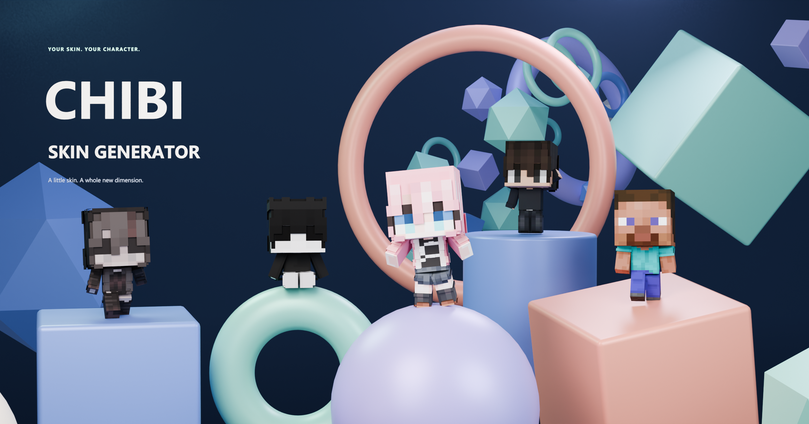
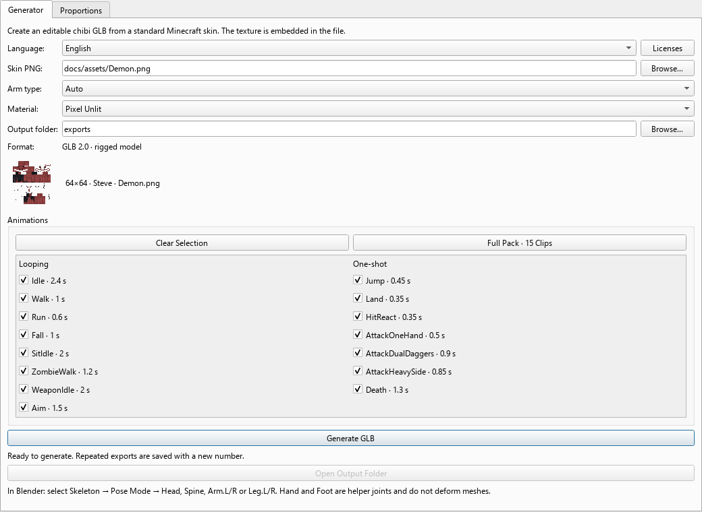
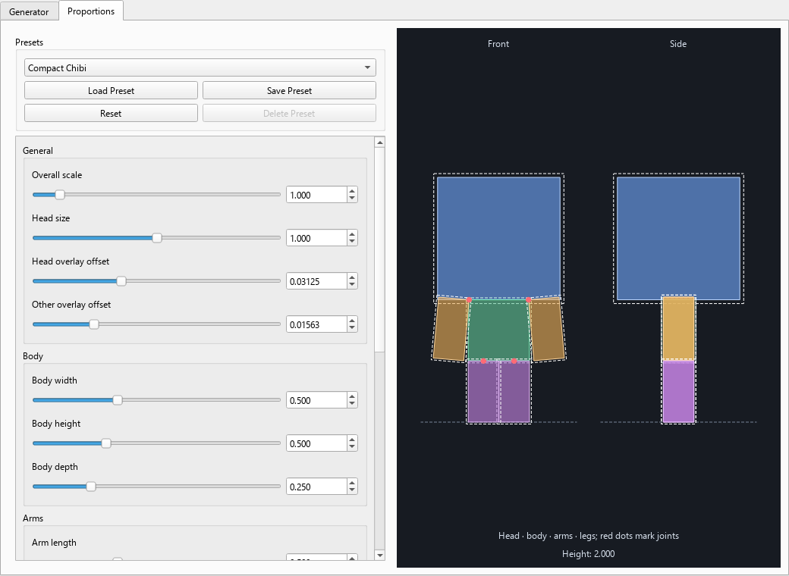

# Chibi Skin Generator

Offline Windows desktop application that converts a standard 64×64 Minecraft
skin PNG into an editable chibi GLB with an embedded texture and a 12-joint rig.

## Download

Get `ChibiSkinGenerator-0.8.0-Windows-x64-EN-RU.zip` from
[Releases](https://github.com/Chahmetski/ChibiSkinGenerator/releases).
Extract the entire ZIP and run `ChibiSkinGenerator.exe`. Keep `_internal/`
beside the EXE. Python and Blender are not required for generation.

## Languages

Use **Language** at the top of the Generator tab to switch between **English**
and **Русский** immediately. Your choice is saved for the next launch.
Preset data, paths and animation selections are preserved when switching.

## Features

- Actual 64×64 PNG validation; Steve, Alex and Auto arm selection.
- Separate base and overlay layers: 12 editable meshes, alpha-mask overlays.
- One glTF skin with 12 stable joints and hard per-part weights.
- Fifteen optional in-place animation clips.
- Compact Chibi, Balanced Chibi, Big Head and Legacy presets.
- Linked proportion controls, JSON user presets and session persistence.
- Embedded pixel texture with nearest sampling; Pixel Unlit / PBR Lit.
- Numbered exports preserve existing files. Generation runs in a worker thread.

## Interface

## Development

Use Windows and **Python 3.11.9**. Run `setup.bat`, then `run.bat`.
Run `.venv\Scripts\python.exe -m pytest` for tests.
Run `build.bat` to prepare upstream Qt sources and create a verified portable
ZIP, a dependency source archive, and SHA-256 checksums in `dist/`.
Build-time downloads do not add any network dependency to the application.

## Licenses and assets

The application uses Qt / PySide6 under LGPLv3. The release includes license
texts, notices and library replacement instructions. Matching unmodified Qt
and PySide6 source archives are supplied as a separate release asset.
See [third-party notices](THIRD_PARTY_NOTICES.md) and the in-app **Licenses** button.

No open-source license has been selected for the project's own code yet.
A private repository does not change third-party library obligations when
binaries are distributed. Do not assume that the code or example skins are MIT-licensed.
User skins and exported textures retain their original authors' rights.

**NOT AN OFFICIAL MINECRAFT PRODUCT. NOT APPROVED BY OR ASSOCIATED WITH MOJANG OR MICROSOFT.**

## Limits and documentation

Only standard 64×64 PNG skins. No elbows, knees, weapons, root motion or 3D preview.
Auto arm detection is heuristic. Walk/Run are rotation-only; physical foot
placement is limited by rigid cuboid limbs. Game movement, damage and animation
transitions are implemented in the consuming game.

[English guide](README_EN.md) · [Russian technical guide](README_RU.md)
